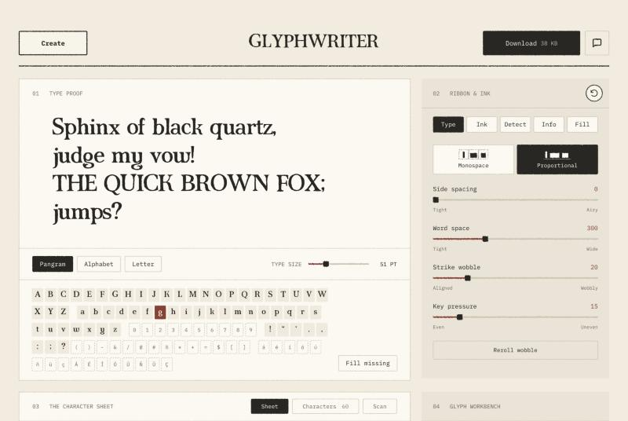

# Glyphwriter

Turn a scanned sheet of handwritten or typewritten letters into a real `.ttf` font, with every rough, inky edge intact.

[**Open the app**](https://giannacrisha.github.io/glyphwriter/) · no install, no sign-up, nothing leaves your device


-903D32)



---

## Try it in two minutes

1. Open [giannacrisha.github.io/glyphwriter](https://giannacrisha.github.io/glyphwriter/).
2. Hit **Create**, download the printable template, and fill one letter per box in dark ink.
3. Scan or photograph the sheet, upload it, and press **Download** when the preview looks right.

Running it locally is the same thing without the hosting:

```sh
git clone https://github.com/giannacrisha/glyphwriter.git
open glyphwriter/index.html
```

No `npm install`, no bundler, no dev server. It is one HTML file.

## Why it exists

Most font builders redraw your letters as clean Bezier curves, which is exactly what you do not want from a typewriter or a dip pen. Glyphwriter traces the ink edge where the ink actually stopped. Ink bleed, dry patches, uneven strikes, and paper grain survive into the font file.

## How it works

| Step | What happens |
|---|---|
| **Create** | Printable template, optional helplines and character references, so a blank sheet is never the blocker |
| **Detect** | Finds connected components in the scan, rejoins dots and accents with their letters, and maps everything to characters in reading order |
| **Trace** | Marching squares on the thresholded bitmap, then closed-path simplification that keeps the rough edge |
| **Tune** | Ink weight, smoothing, point cleanup, trace detail, extra grit, strike wobble, key pressure, monospace or proportional spacing |
| **Workbench** | Per-glyph loupe: nudge baselines, resize, stretch, compare against neighbors, reroll wobble, reset |
| **Fill missing** | Matches a Google Fonts face to your letters by shape overlap, calibrates width and stroke weight to yours, and generates the digits, symbols, and accents you skipped |
| **Download** | Writes the TrueType tables by hand (`glyf`, `loca`, `cmap`, `hmtx`, `OS/2`, `name`, `post`) with your family name, designer, license, and version baked in |

Coverage spans uppercase, lowercase, digits, `!"'.,:;?()-&/@#%*+=$[]`, and accented Latin.

## The privacy claim, stated precisely

Detection, tracing, glyph generation, and font building are plain JavaScript executing on your own machine. There is no server, no AI model, no account, and no telemetry. Your scan is never uploaded.

One network request exists: Google Fonts, which serves the IBM Plex Mono interface type and the reference faces that **Fill missing** measures against. Block it and the app still detects, traces, tunes, and exports; only Fill missing goes dark.

## Tuning reference

| Control | Range | Use it when |
|---|---|---|
| Ink weight | Light to Heavy | The scan came out thin, or the ink blotted |
| Smoothing | Raw scan to Smooth | You want some of the noise gone without losing the edge |
| Point cleanup | Every point to Fewer points | The outline is heavier than it needs to be |
| Trace detail | Coarse to Fine | Fine serifs or hairlines are disappearing |
| Extra grit | None to Gritty | The paper was too clean |
| Strike wobble | Aligned to Wobbly | Letters sit too perfectly on the baseline |
| Key pressure | Even to Uneven | Every letter hits with the same weight |
| Speck filter | Keep all to Drop dust | Dust and scanner noise are being read as glyphs |
| Part joining | Separate to Join | Dots on `i` and `j` are detaching, or two letters are merging |

Speck filter and part joining set themselves when a sheet loads, by matching the number of detected glyphs to the characters the sheet is meant to hold. Reach for them only when a sheet is unusual.

Settings and project state persist in `localStorage`, so a reload does not cost you the session.

## What it does not do

It will not clean up a bad scan for you. Light pencil, lined notebook paper, and phone photos at an angle all produce poor detection. Flat, dark ink on white paper is what works.

It does not yet export WOFF2, kern proportional pairs, or cycle alternate drawings per letter. Those are open.

## Repo layout

```
index.html          the whole app: markup, styles, script, no build step
assets/            the gerif display face, icons, and social card
CLAUDE.md           architecture notes and backlog
```

## Contributing

Issues and pull requests are welcome. [CONTRIBUTING.md](CONTRIBUTING.md) covers the two rules that matter: stay at zero dependencies, and keep everything client-side.

## License

MIT. See [LICENSE](LICENSE).

## Credits

Built by [Gianna Crisha Saludo](https://giannacrisha.com).
